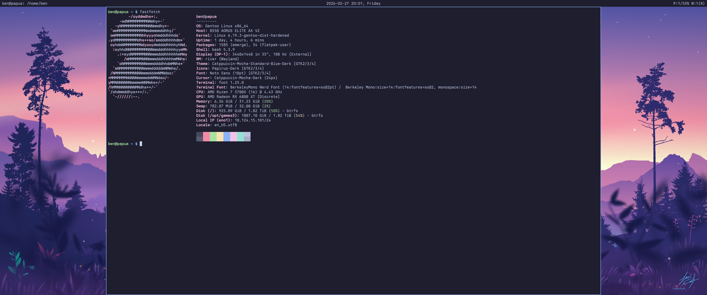
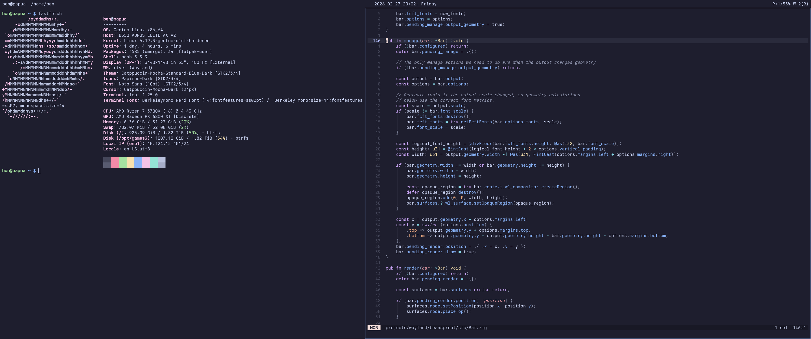

> Originally developed at [codeberg.org/beansprout/beansprout](https://codeberg.org/beansprout/beansprout) · GPL-3.0

# beansprout




## Overview

A tiling window manager for the [river](https://codeberg.org/river/river/) Wayland compositor written in Zig.
The window manager communicates using the [river-window-management-v1](protocol/river-window-management-v1.xml)
protocol, as well as some of River's additional Wayland protocols.

Beansprout uses a primary/stack tiling layout inspired by dwm with a customizable ratio and primary count.
Similarly, beansprout has a 32-bit tag system, rather than workspaces. Each output has its own tags and own
primary count/ratio.

## Downloading

Tarballs are available for x86_64 on the Codeberg releases page.

Tarballs starting with version v1.0.0 are signed with [minisign](https://jedisct1.github.io/minisign/) using the public key:

`RWQcxCZRzxZ6AifHx9eOsLFLI5zhC46dhFIBP+CwEsZxDzotewvh0a4D`

## Building from Source

Requires [Zig](https://ziglang.org/) 0.16.0 or later.

### Dependencies

To compile beansprout, you'll need the dependencies found below. I've listed the package names for Gentoo,
Debian/Ubuntu and Fedora, but they likely exist on all major distros.

Needed at both build-time and runtime:

| Dependency         | Gentoo Name                 | Debian/Ubuntu Name  | Fedora                     |
|--------------------|-----------------------------|---------------------|----------------------------|
| wayland-client     | `dev-libs/wayland`          | `libwayland-dev`    | `wayland-devel`            |
| pixman             | `x11-libs/pixman`           | `libpixman-1-dev`   | `pixman-devel`             |
| xkbcommon          | `x11-libs/libxkbcommon`     | `libxkbcommon-dev`  | `libxkbcommon-devel`       |
| fcft               | `media-libs/fcft`           | `libfcft-dev`       | `fcft-devel`               |

Only needed at build-time:

| Dependency         | Gentoo Name                  | Debian/Ubuntu Name  | Fedora                    |
|--------------------|------------------------------|---------------------|---------------------------|
| wayland-protocols  | `dev-libs/wayland-protocols` | `wayland-protocols` | `wayland-protocols-devel` |

Optional (for building man pages):

| Dependency         | Gentoo Name                  | Debian/Ubuntu Name  | Fedora                    |
|--------------------|------------------------------|---------------------|---------------------------|
| scdoc              | `app-text/scdoc`             | `scdoc`             | `scdoc`                   |

#### Note for Gentoo Users

Beansprout is available in my personal [ebuild repo](https://codeberg.org/bwbuhse/buhserepo) and in GURU.

### Build

Build and install with:

```
zig build -Doptimize=ReleaseSafe --prefix ~/.local install
```

Run `zig build -h` to see a list of all options.

## Usage

You can either add `beansprout` to the river `init` file or directly run `river -c beansprout`.

If no keybinds are configured (e.g. missing or broken config), beansprout provides
fallback keybinds including `Ctrl+Alt+Delete` to exit the River session, `Super+Shift+R`
to reload config, and `Super+T` to spawn a terminal.

If beansprout crashes, you can use River's hardcoded `Ctrl+Alt F1`–`F12` bindings to
switch to another TTY. From there, you can kill River or restart beansprout (you will
need to set `WAYLAND_DISPLAY` yourself, e.g. `WAYLAND_DISPLAY=wayland-1 beansprout`).

## Configuration

Beansprout is configured with a [KDL](https://kdl.dev) file at
`$XDG_CONFIG_HOME/beansprout/config.kdl`. See `beansprout(5)` for a full reference
and [examples/config.kdl](examples/config.kdl) for an example config.

## Support

Feel free to join #beansprout on [libera.chat](https://libera.chat/) to ask for help!

## Licensing

This project follows the [REUSE Specification](https://reuse.software/spec-3.3/),
all files have SPDX copyright and license information and/or are listed under
`REUSE.toml`.

In overview:

- beansprout's source code is released under the GPL-3.0-only license.
- beansprout's documentation is released under the CC-BY-4.0 license.
- beansprout's examples are released under the CC0-1.0 license.

All licenses can be found under `LICENSES`

## LLM/"AI" Contributions
Contributions **must not** include content generated by large language models or other probabilistic tools, including but not limited to Copilot or ChatGPT. This policy covers code, documentation, pull requests, issues, comments, and any other contributions to the beansprout project.